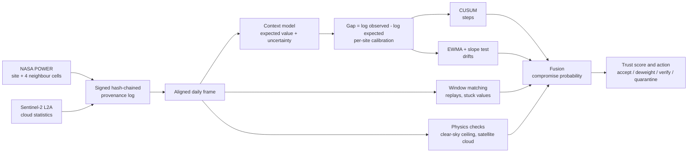
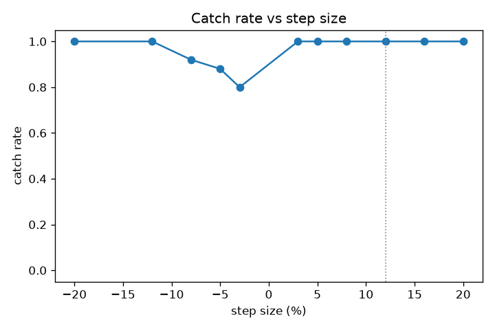
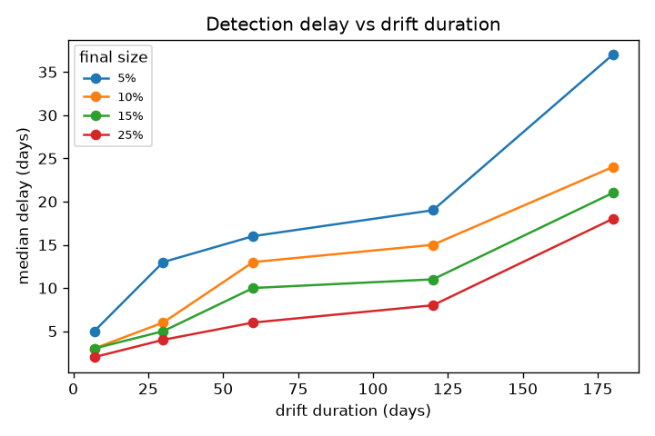
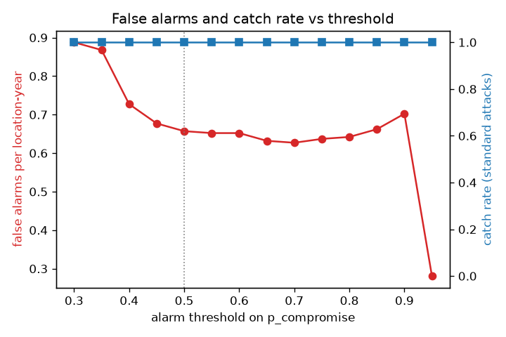
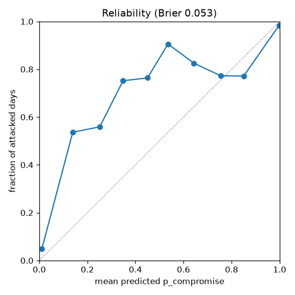

# VERITAS: Weather Data Trust Monitor

**TSYP14 "Ground Truth Under Attack", Track 2: False-Data Injection.**

A daily solar-radiation series can be falsified quietly: a 12% bias, a slow drift or a replayed week still looks like plausible weather, passes range checks, and shifts the irrigation, drought and insurance decisions built on it. VERITAS answers this with two independent layers:

- **Cryptography** proves that data has not changed since it was recorded: every file and every sensor reading is signed with Ed25519 and chained into a tamper-evident log.
- **Context** proves that the data still makes sense: each day is checked against what the attacker cannot control (neighbouring grid cells, other variables, clear-sky physics and Sentinel-2 cloud), and a daily trust score drives an action.

The second layer exists because the first one has a blind spot: a compromised sensor signs its false values with a valid key, and the signatures accept it.

**Headline result:** on 5 locations and a year the system never saw, every standard attack (12% step, drift to 15%, 7-day replay) was caught in all 100 runs, with 0.4 to 0.7 false-alarm episodes per location-year, at a median 0.153 ms per location-day on a laptop.

---

## Contents

1. [How it works](#how-it-works)
2. [Results](#results)
3. [Quick start](#quick-start)
4. [Demo and web app](#demo-and-web-app)
5. [Step by step](#step-by-step)
6. [Provenance log](#provenance-log)
7. [Outputs](#outputs)
8. [Reproducibility](#reproducibility)
9. [Repository map](#repository-map)
10. [Known limitations](#known-limitations)
11. [Documentation](#documentation)

---

## How it works



**1. Record.** Every downloaded and derived file gets a signed record (SHA-256 of the content, source, inputs, code version, link to the previous record). An emulated sensor and gateway apply the same idea per reading: signature, sequence number, timestamp window and nonce.

**2. Predict.** A ridge regression predicts each day's value from inputs the attacker does not touch: four neighbouring NASA POWER cells, clear-sky radiation, temperature, humidity, precipitation and season. It never sees the protected value.

**3. Compare.** The gap `log(observed) - log(expected)` turns a multiplicative attack into a constant shift: a 12% step adds 0.113 on every attacked day, at any site and season. A per-site calibration, frozen after the first year, removes the local bias.

**4. Detect.** Four causal detectors (day *t* only uses data up to *t*):

| Detector | Catches | Idea |
|---|---|---|
| CUSUM, two-sided | steps | accumulates evidence of a lasting shift; dates the change after an alarm |
| EWMA + rolling slope test | drifts | a slow level change, or a ramp before it gets large |
| Window matching | replays, stuck sensors | an exact or near copy of an earlier 7-day window; repeated identical values |
| Physics checks | inflation, cloud conflicts | all-sky radiation above clear-sky; sunny readings on a day Sentinel-2 sees heavy cloud |

**5. Decide.** The detector scores are fused into a compromise probability *p* and a trust score 1 - *p*:

| Trust | Action |
|---|---|
| ≥ 0.8 | accept |
| 0.5 to 0.8 | deweight |
| 0.2 to 0.5 | verify (ask for independent confirmation) |
| < 0.2, or exact replay / stuck | quarantine, with an alert |

All thresholds were tuned on 10 train locations only, using out-of-fold predictions.

---

## Results

Unseen test locations (5 sites × 20 seeds per attack), test year 2024. Full tables in [`results/summary.md`](results/summary.md).

| Attack | Caught | Median delay | False alarms / location-year | F1 | ROC-AUC |
|---|---|---|---|---|---|
| Step +12% | 100% | 2 days | 0.40 | 0.93 | 0.99 |
| Drift to +15% over 60 days | 100% | 10 days | 0.40 | 0.92 | 0.96 |
| 7-day replay | 100% | 4.5 days | 0.71 | 0.33 | 0.86 |
| Adaptive step (0.9 × detection limit = 2.7%) | 100% | 4.5 days | 0.41 | 0.77 | 0.85 |

The same attacks on the 10 train locations in the unseen year 2024: all caught, median delays of 3, 13 and 4 days.

**Evasion.** Every upward step from +3% is caught. Downward steps are harder (−3%: 80% caught, −8%: 92%). Slower, smaller drifts are caught later: 5% over 180 days after a median of 37 days. Adding noise to a 7-day replay to defeat exact matching still leaves 96% caught; 3-day replays are caught 36% of the time.

| Catch rate by step size | Delay by drift speed |
|---|---|
|  |  |

| Alarm threshold trade-off | Calibration |
|---|---|
|  |  |

**Cost.** Median 0.153 ms per location-day and under 5 MB of peak memory. Signing a reading takes 0.038 ms; checking it 0.089 ms. A full benchmark (1,965 runs) takes 2 to 6 minutes on a laptop CPU.

---

## Quick start

Python 3.11, CPU only.

```
conda env create -f environment.yml
conda activate eo-trust
```

or, without conda:

```
python -m venv .venv
.venv\Scripts\activate              # Linux/macOS: source .venv/bin/activate
pip install -r requirements.lock
```

The clean data and trained models are in the repository, so everything below runs offline.

Full pipeline in one command:

```
python scripts/run_all.py            # download -> align -> train -> tune -> benchmark -> verify
python scripts/run_all.py --offline  # cached data only, no network
python scripts/run_all.py --quick    # quick tuning and benchmark
```

Finished steps are skipped; `--force` re-runs training, tuning and the benchmark. A full first run takes about 15 minutes.

---

## Demo and web app

```
python scripts/demo.py
```

Injects a 12% step into a test location, prints the trust score and action day by day as the attack starts, then shows that editing a logged file is caught by the signed log.

```
streamlit run app/app.py
```

| Page | What it shows |
|---|---|
| Home | system status and headline results |
| Attack lab | choose a location and attack; see observed vs expected, detector scores, trust, and why each day was flagged |
| Live replay | the same run revealed day by day, with an alert when quarantine starts |
| Integrity | the provenance log, live verification, tamper demo, gateway cases, overhead |
| Benchmark | all tables and charts |

---

## Step by step

```
python -m src.data.power --all                 # NASA POWER (no key needed)
python -m src.data.sentinel2 --all             # Sentinel-2 (optional, needs CDSE credentials)
python -m src.data.align --all                 # clean, aligned frames
python -m src.detect.context_model --train     # expected-value model (train locations only)
python -m src.eval.tune                        # thresholds -> config/tuned.yaml
python -m src.eval.run_benchmark --sweep       # benchmark -> results/
python -m src.pipeline --location kairouan --attack step --size 0.12 --seed 1
python -m src.trust.gateway --demo             # signed sensor + gateway attack cases
pytest                                         # 267 offline tests
```

**Sentinel-2 credentials (optional).** Create a free Copernicus Data Space account and an OAuth client (Sentinel Hub dashboard, User settings → OAuth clients), then set them for the current terminal only:

```
$env:CDSE_CLIENT_ID="..."          # bash: export CDSE_CLIENT_ID=...
$env:CDSE_CLIENT_SECRET="..."
```

Never write credentials into a file in the repository. Without them the system still runs; only the cloud check is inactive.

---

## Provenance log

`data/provenance/log.jsonl` holds one signed, hash-chained record per downloaded or derived file. Check it on a fresh clone (raw data is not in the repository, so file contents are skipped):

```
python -m src.trust.verify --allow-missing --trust 21ded33c4cec6bf2 --expected-head 038ee7c91d72c20521f0b32035a0cf426e98a79486253f8daa9c01d8370ec7af
```

`--trust` pins the signing key id of the reference run; `--expected-head` checks that no records were removed from the end (120 records). Only one machine should append to the log, since another machine would create its own key.

---

## Outputs

| Path | Content |
|---|---|
| `data/clean/<location>.parquet` | aligned daily frames |
| `models/context_model.joblib`, `models/fusion.joblib` | trained models |
| `config/tuned.yaml` | tuned thresholds and a record of the tuning run |
| `results/summary.md`, `benchmark_table.csv`, `per_scenario.csv`, `system_info.json` | benchmark tables and run details |
| `results/*.png` | the four figures above |
| `data/provenance/log.jsonl` | signed record of every download and derived file |

---

## Reproducibility

- **Deterministic:** every random choice takes a seed. Rerunning the benchmark reproduces `results/benchmark_table.csv` exactly.
- **No leakage:** split by location and by year (10 train, 5 test locations; 2024 held out). The context model and all thresholds use train locations and earlier years only, and the code refuses test frames for training and tuning.
- **Causal:** day *t* only uses data up to day *t*; a test compares a run on a prefix with the full run.

**Tested on:** Intel x86-64 laptop CPU (8 physical / 12 logical cores), 31.7 GB RAM, Windows (build 10.0.22621), Python 3.11.18, NumPy 2.4.6, pandas 3.1.0, no GPU. Details in `results/system_info.json`.

---

## Repository map

```
config/          settings.yaml (all settings), tuned.yaml (written by tuning)
src/common.py    paths, config loading, logging
src/data/        power.py (NASA POWER), sentinel2.py (Sentinel-2), align.py (clean frames)
src/trust/       provenance.py (signed log), verify.py (verification, tamper demo), gateway.py (signed sensor)
src/attacks/     inject.py (step, drift, replay, spike, stuck, adaptive, slow ramp)
src/detect/      context_model.py, step.py, drift.py, replay.py, consistency.py, fusion.py
src/respond/     policy.py (trust -> action, hysteresis)
src/pipeline.py  end-to-end daily pipeline
src/eval/        scenarios.py, metrics.py, run_benchmark.py, tune.py
app/             Streamlit web app
scripts/         run_all.py, demo.py
docs/            DATA.md, USER_GUIDE.md
tests/           pytest suite (synthetic data, no internet)
results/         benchmark outputs
```

---

## Known limitations

- **Signatures prove integrity, not honesty.** They show that data is unchanged since it was signed, not that the source told the truth; that is the detectors' job.
- **The context is assumed honest.** An attacker who also changes the neighbouring cells and the other variables consistently is out of scope.
- **Calibration uses the first year.** An attack already active then is absorbed into the calibration.
- **Cloudy tropical sites are slow.** At the test site abidjan, a 12% step takes a median of about a month to alarm, and a 2.7% step about five months.
- **Downward bias is harder.** The clear-sky check only sees inflated values; deflation relies on the statistical detectors and is caught later.
- **Short replays.** 3-day replays are shorter than the matching window and are caught 36% of the time.
- **Replay per-day precision is low** (0.26): an alarm persists for a few days after the copied week ends.
- **Gridded data as the sensor.** NASA POWER plays the role of the in-situ stream; on a real ground station the context model would be less accurate and the clear-sky check would need a tolerance.

---

## Documentation

| Document | Covers |
|---|---|
| [docs/DATA.md](docs/DATA.md) | the official datasets (NASA POWER, Sentinel-2 L2A): variables, grid, locations, cleaning, provenance, acknowledgements |
| [docs/USER_GUIDE.md](docs/USER_GUIDE.md) | demo, web app, running scenarios, reproducing results, trust anchor, troubleshooting |
| [results/summary.md](results/summary.md) | all benchmark tables |

**Data acknowledgements.** The data was obtained from the National Aeronautics and Space Administration (NASA) Langley Research Center (LaRC) Prediction of Worldwide Energy Resource (POWER) Project funded through the NASA Earth Science/Applied Science Program. Contains modified Copernicus Sentinel data 2018–2024, processed with the Sentinel Hub Statistical API of the Copernicus Data Space Ecosystem.